# fm1-rocket-os

fm1-rocket-os is **work in progress**: custom firmware for the M-VAVE FM-1 that turns it into a
standalone clip-launching performance instrument. The plan, design and decisions are in
[docs/README.md](docs/README.md).

It forks **[X0X](https://github.com/charlesvestal/fm1-x0x) by Charles Vestal**, which itself forks
**[Felucca](https://github.com/hugelton/Felucca) by Leo Kuroshita (@kurogedelic), Hügelton
Instruments**.

## Using fm1-rocket-os

This is the short version, for someone with a fresh FM-1. The
[interaction model](docs/product/interaction-model.md) is the full reference. Every screen image
below is a real render from the firmware, taken by the `tests/scenarios/readme_*.x0x` scenarios
(regenerate them with `make scenarios` then `tools/readme_shots.py`). The panel drawing at the top
is a diagram, not a screen.

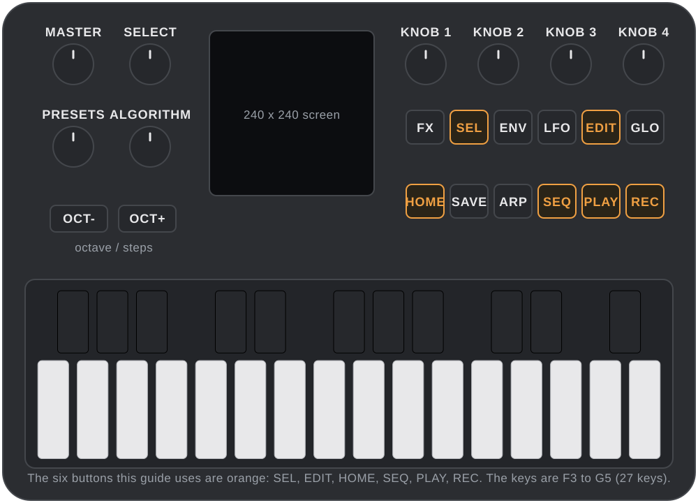

### Install, and return to stock

Install the built firmware (`build/x0x.fwsc`, or a release file) from a computer with the FM-1 on
USB:

```
python3 tools/fm1_install.py build/x0x.fwsc
```

Don't unplug the FM-1 while it writes. To put M-VAVE's firmware back, the
[X0X web installer](https://charlesvestal.github.io/fm1-x0x/install/)'s "Back to the stock
firmware" does it, and M-VAVE's own M-UPGRADE works too.

### The two modes

STUDIO builds the song; LIVE performs it. The FM-1 starts in STUDIO, on the song home.

**Hold PLAY** for about 600 ms: a ring fills, then says LIVE. Hold PLAY again to come back. A
short PLAY tap just starts and stops the transport.

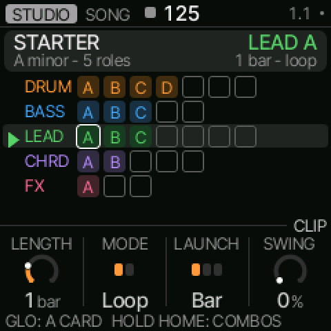
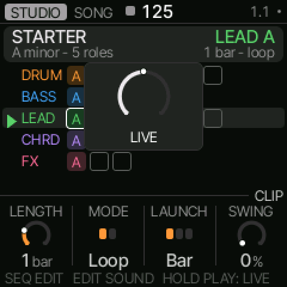
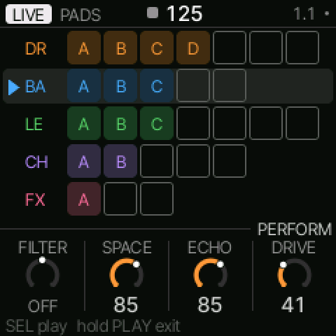

### Record a clip (a sequence)

A song is a set of **roles** (DRUMS, BASS, LEAD, CHORDS, FX). Each role holds **clips**, its
sequences, lettered A, B, C…

Put the cursor on an **empty slot**: turn **SELECT** to pick the role, **ALGORITHM** to move along
the row. Press **REC** — recording starts at the next bar (at once, if the transport is stopped).
Play the part, then press **REC** again to close the loop. The new clip plays.

To step a clip in by hand instead, press **SEQ** on the slot: an empty slot becomes an empty clip
and opens the step editor. **SEQ** cycles NOTES → MOTION → SETTINGS.

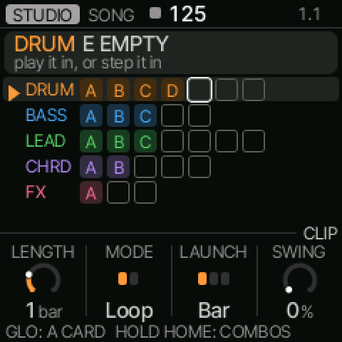
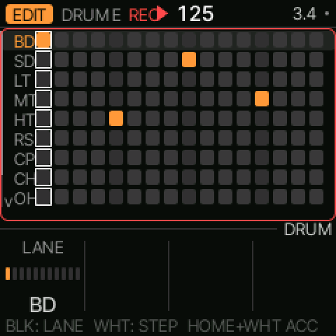
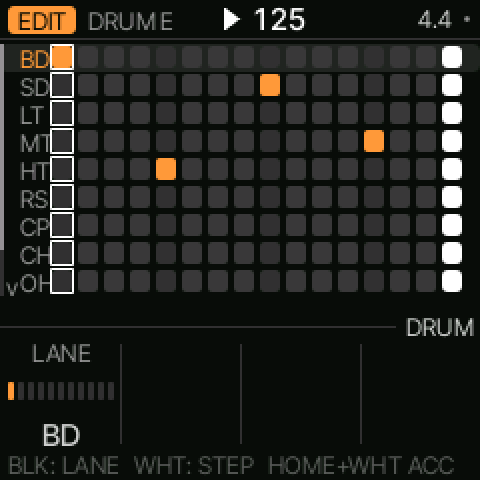
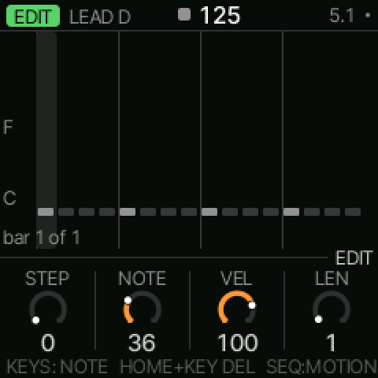

### Erase a clip

Put the cursor on the clip and **hold HOME, then hold the pad**, for about 1.5 s. A ring fills and
names the clip; release it early and nothing changes. **HOME + REC** undoes the clear
(**HOME + PLAY** redoes it).

Stage lock — a per-song setting (see LIVE SETUP) — refuses a clear while the transport is playing.

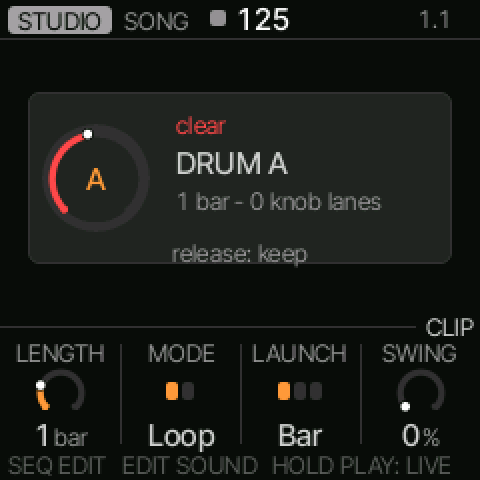
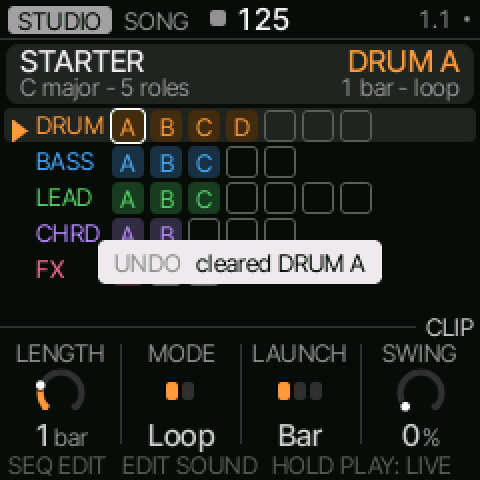
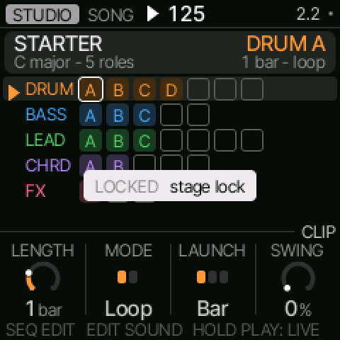

### Play clips together, and in order

One clip plays per role, and the roles play together: launch a clip on DRUMS and one on BASS and
you hear both. Launching a second clip on a role replaces the first.

There is **no chain** in v1. X0X's chain and arranger were removed
([ADR-0004](docs/decisions/0004-remove-classic-shorten-delay.md)), and keeping a take as the
arrangement is deferred. To play clips in order, launch them one after another in LIVE — each
waits for its own quantize point — and record a **take**. The take replays the whole sequence.

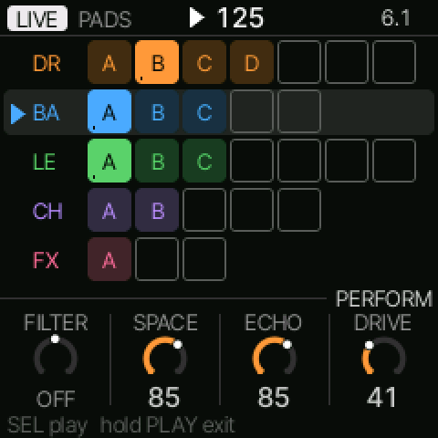
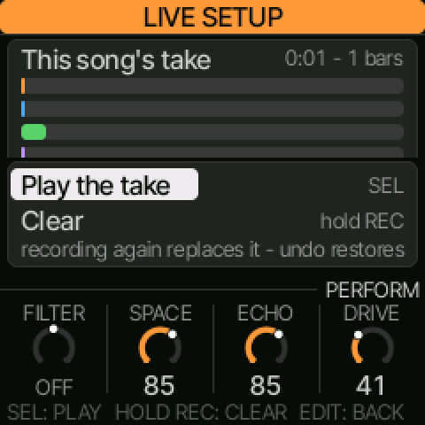

### LIVE as a launchpad

Hold PLAY to enter LIVE. The **PADS** layer lays the clips on the keys by role:
DRUMS F3–B3 · BASS C4–E4 · LEAD F4–B4 · CHORDS C5–E5 · FX F5–G5.

- **Tap a pad** to launch its clip at its quantize point. **Tap the playing clip** to stop it.
- **HOME + tap** launches immediately.
- **ALGORITHM** moves the focused role (the one that launched last).

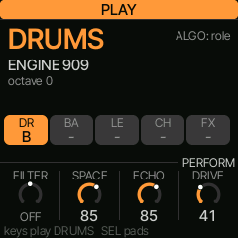

Press **SEL** to switch to the **PLAY** layer: the keys then play the focused role in the song's
key and scale — a scale-degree keyboard, so the first key is the tonic and the keys step up the
scale across octaves — and OCT− / OCT+ transpose. The card shows the key and scale. SEL again
returns to PADS.

**Punch FX.** Hold (or double-tap) **FX** to turn the first six keys into repeat 1/8, repeat 1/16,
tape stop, filter dive, echo throw and freeze. **Tap latches**, **hold is momentary**. The upper
keys mute roles. **HOME + FX** resets every effect. Effects and mutes reset when you leave LIVE.

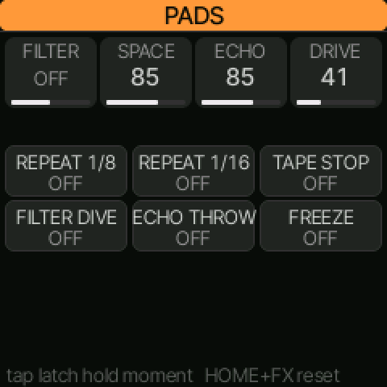

**LIVE SETUP.** Press **EDIT** in LIVE. SELECT picks a row, ALGORITHM changes its value, SEL opens
a row, EDIT finishes, HOME goes back:

- **Assign keys** — hold a key and turn PRESETS through every clip, the five role stops, the six
  punch FX, Live note and None; release commits.
- **Launch on** — Next bar, Next beat or End of clip, for new clips.
- **Stage lock** — On or Off.
- **External keys**, **Program change** — the MIDI channel and quantized clip launch.
- **Clock in** — Auto follows an incoming clock; Internal keeps the song tempo.
- **Take** — SEL opens the take card.

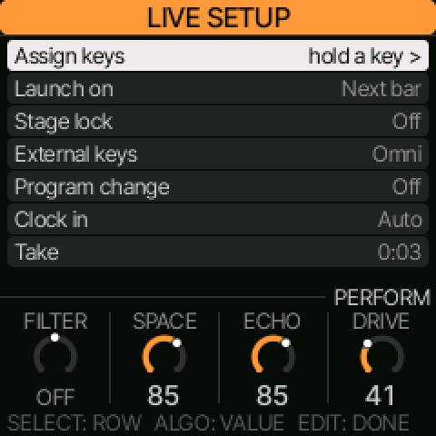
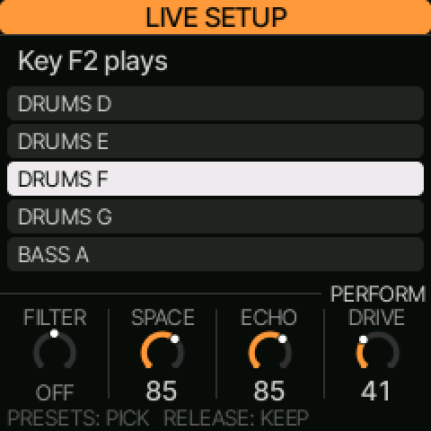

**The take** is your most recent LIVE recording: launches, stops, mutes, FX punches, knob moves
and notes. Press **REC** to record (it starts at the next bar) and **REC** again to stop. Open it
under LIVE SETUP → Take: **SEL** plays it, **PLAY** or **SEL** stops it. **Hold REC** for 1.5 s to
clear it — the ring fills, the clips stay, and the music keeps playing.

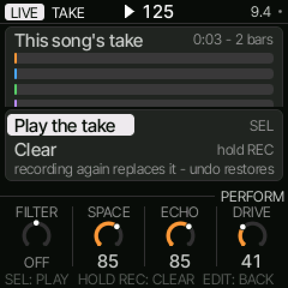
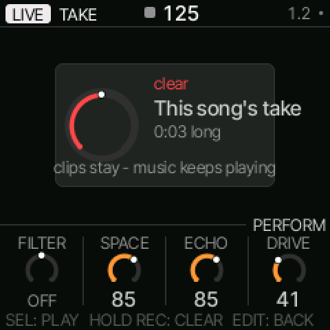

### Cheat sheet and help

**Hold HOME** for the cheat sheet of everything HOME does on the current screen. **GLO + any
button** shows that button's card.

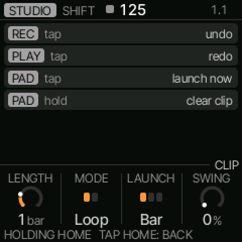
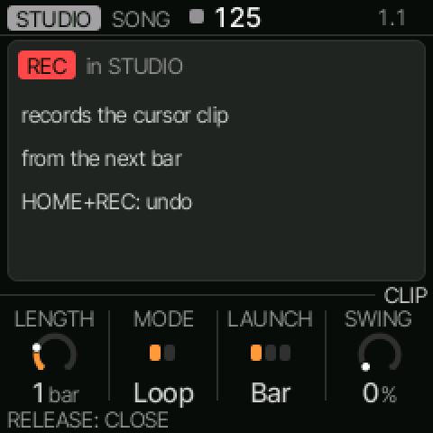

---

# X0X's README (the upstream base) — its pattern and song sections don't apply

Everything below this line is X0X's own README, kept from the fork. It describes the upstream
groovebox. **Its pattern and song sections do not apply to this firmware:** fm1-rocket-os removed
X0X's patterns, its pattern sequencer and its song arranger
([ADR-0004](docs/decisions/0004-remove-classic-shorten-delay.md)), so skip those. The sound
engines, and the FX, mix and global pages, still apply.

# X0X for the M-VAVE FM-1

X0X turns the M-VAVE FM-1 into a groovebox: a **909**, an **808** and two **303s** with an acid line
generator, all playing at once. Each part can play its own pattern,
you can string patterns into a song, and you can record knob moves. Everything runs in stereo,
with a shared reverb and tape delay and a punchy master compressor. Over USB, the FM-1 is both a
MIDI device and an audio input, with no driver needed.

The factory sound is set up for big beat, so it should make noise the moment you press PLAY.

[](https://www.youtube.com/watch?v=cZLYrZaLDUk)

- **Try it in your browser** (no FM-1 needed): <https://charlesvestal.github.io/fm1-x0x/emu/>
- **Install it** (Chrome or Edge, with the FM-1 plugged in): <https://charlesvestal.github.io/fm1-x0x/install/>
- **Read the manual**: <https://charlesvestal.github.io/fm1-x0x/manual/>
- **Download the firmware file**: [releases](https://github.com/charlesvestal/fm1-x0x/releases)

> **X0X is in beta.** It's solid for everyday playing, but a very busy pattern can push the FM-1
> to its limit. When that happens, X0X trades a little sound quality to keep playing rather than
> drop out. Installing it is at your own risk, though it's hard to get stuck: the web installer
> can put M-VAVE's firmware back, an FM-1 that keeps crashing starts in a safe mode, and the
> manual's Troubleshooting section covers the rest.

## What's inside

| Part | What it is | Based on |
|---|---|---|
| 909 | 11 voices: modelled kick, snare, toms, rim and clap, with sampled hats and cymbals | [9W9](https://github.com/athousanddetails/schwung-9W9) (samples from ER-99) |
| 808 | 11 tracks, including the 808's tom/conga, rim/claves and clap/maracas switches | [8W8](https://github.com/athousanddetails/schwung-8W8) |
| 303 A and B | Open303 with Devilfish-style ranges, each with a TB-3PO line generator | [schwung-303](https://github.com/charlesvestal/schwung-303), [schwung-tb3po](https://github.com/charlesvestal/schwung-tb3po) |

Each part has its own step length (up to 64 steps) and rate, so parts can drift against each
other. Pattern changes wait for the end of the bar, and patterns can be chained.

X0X is a fork of [Felucca](https://github.com/hugelton/Felucca) by Leo Kuroshita (Hügelton
Instruments). It keeps Felucca's foundations (the hardware layer, USB, the update loader, the web
installer and the storage) and replaces the instrument on top.

## Building and testing

[BUILDING.md](BUILDING.md) explains the toolchain. In short:

```
tests/run_tests.sh      # the maths, the sequencer, every engine against its original, the app in a simulator
./build.sh              # build/x0x.fwsc
```

`host/x0x_host` runs the whole app on a computer from a script (`tests/scenarios/*.x0x`). Button
presses, keys, knob turns and MIDI go in; audio and screenshots come out. That's how most of
X0X is tested before it reaches the FM-1.

## Licence and credits

X0X is GPL-3.0-only, like Felucca, 9W9, 8W8 and schwung-tb3po. Open303 (by Robin Schmidt) is
MIT. The 909's hi-hat, ride and crash samples come from ER-99 (Matthew Cieplak, GPL-3.0). The
fonts are Barlow Semi Condensed and Terminus (SIL OFL 1.1).

Felucca's own assets that aren't under its GPL (the icon set, the panel photo and the Hügelton
drum pack) aren't part of this fork.

M-VAVE and FM-1 are trademarks of their owners. TR-808, TR-909 and TB-303 are Roland trademarks,
used here only to describe what the parts are modelled on. X0X isn't affiliated with or endorsed
by M-VAVE, Roland or Hügelton Instruments.
